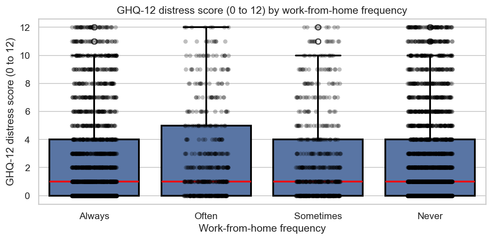

# Remote Working & Mental Health

**Question:** Do people who work from home more often report worse psychological distress?

DATA1002 group project, University of Sydney. Python (pandas, SciPy, seaborn).

## Data
**Data source:** Understanding Society COVID-19 Study (University of Essex, Institute for Social and Economic Research), UK Data Service.

File used: COVID-19 Study, individual responses (`cb_indresp_w`), 14,811 respondents. The survey start dates in the file (`cb_surveystart`) run from 27 May to 2 June 2020.

Variables kept: participant ID, age, sex, weekly hours worked, work-from-home frequency, the GHQ-12 distress score (0 to 12, higher means more distress) and the two survey weights.

## Method
1. Cut the raw file to these 8 columns and renamed them in plain English. The study uses negative codes for missing or not applicable answers, so these were set to blank.
2. Missing values: 6,187 of the 14,811 rows had at least one blank. Of these, 6,097 were missing weekly hours or work-from-home frequency, and 5,871 were recorded as not employed in the study's derived employment status (`cb_sempderived`). The median age of the 6,187 rows with a blank was 66, compared with 48 for the complete rows. This means most blanks came from people who were not in work, so they had no answer for hours or working from home. The other 90 rows were missing only the GHQ-12 score. Dropping all 6,187 rows left 8,624 complete records.
3. Checked for duplicates (none found) and for stray spaces in the text columns (none found). Also checked that every GHQ-12 score is between 0 and 12 and every work-from-home answer is one of the four categories. No rows were removed by these checks.
4. Age: the code keeps ages 14 to 70. The youngest respondent in the data is 16, so in practice this step only removed the 139 people aged over 70. This left 8,485 records.
5. Hours: following the group's filter, the 2,214 respondents working 38 to 70 hours a week were removed. This left 6,271 respondents, all employed or self-employed. Of these, 2,030 reported working 0 hours a week, 4,201 worked more than 0 and under 38 hours, and 40 reported more than 70 hours (up to 168). So the sample is mainly people working under 38 hours a week, including people who were in a job but working no hours.
6. Compared GHQ-12 scores across the four work-from-home groups (Always, Often, Sometimes, Never) with a one-way ANOVA (`scipy.stats.f_oneway`).

## Result


| WFH frequency | n | Mean GHQ-12 | Median |
|---|---|---|---|
| Always | 2,073 | 2.77 | 1 |
| Often | 491 | 2.87 | 1 |
| Sometimes | 605 | 2.54 | 1 |
| Never | 3,102 | 2.64 | 1 |

**No significant difference between groups (p = 0.24).** The mean score ranges from 2.54 (Sometimes) to 2.87 (Often), and the median is 1 in every group. Therefore, this sample gives no evidence that people who work from home more often report more distress.

## Limitations
- GHQ-12 scores are heavily right-skewed (median 1 in every group), so ANOVA's normality assumption is shaky. A Kruskal-Wallis test would be a useful check.
- The hours filter removed everyone working 38 to 70 hours a week, so the result does not cover them. The sample also still includes 2,030 people reporting 0 hours and 40 reporting more than 70 hours. Some of these report 168 hours, which is every hour in a week, so those values look unreliable.
- Most dropped rows were people not in work, which fits the question. However, 369 rows had no GHQ-12 score, and dropping them may bias the result if missing scores relate to wellbeing.
- Observational data: no causal claim.
- Survey weights are in the data but were not applied, so the results describe this sample rather than the UK population.

## Repository
- `understanding-society-analysis/`: the analysis above. `wfh_vs_ghq12_analysis.ipynb` reads the raw file `cb_indresp_w.csv`, saves the 8 selected columns, plus a flag for a GHQ-12 score of 4 or more, as `cb_indresp_w_filtered.csv`, and saves the 6,271 cleaned rows as `cb_indresp_w_filtered_cleaned.csv`.
- `figures/`: the box plot saved by the notebook.
- `screening-nsw-remote-working-survey/`: a 2021 remote working survey (`2021_rws.csv`, 1,512 responses) with an exploration script and two charts. The group looked at this dataset and set it aside. It has no distress or mental health scale, only single questions such as how much people agree that "On days when I work remotely I feel better".
- `screening-kaggle-remote-work/`: an "Impact of Remote Work on Mental Health" dataset (5,000 rows) with cleaning and chart code. The group looked at this dataset and set it aside. Stress is only recorded as Low, Medium or High, and the files give no detail on how the data was collected.

## How to run
```
pip install -r requirements.txt
```
Then open `understanding-society-analysis/wfh_vs_ghq12_analysis.ipynb` from inside its folder (it reads the CSV files by relative path) and run all cells. The notebook saves the chart to `figures/ghq12_by_wfh.png`.
